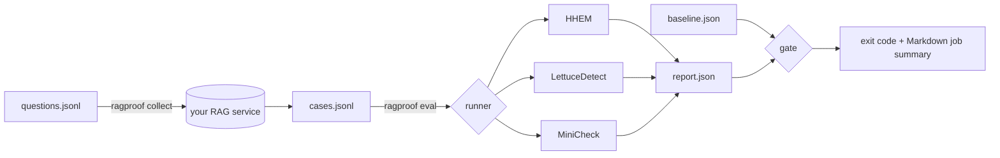

# ragproof

[](https://github.com/DorukMaltepe/faithful_rag/actions/workflows/ci.yml)
[](LICENSE)

**Unit tests for hallucinations.** ragproof scores every answer your RAG pipeline produces
against the context it retrieved, and fails the build when faithfulness drops, so a
prompt tweak, a new chunking strategy or a model swap can't quietly start making
things up.

```text
$ ragproof eval examples/cases.jsonl -s lexical --threshold 0.8
lexical        mean=0.7214  min=0.3750  pass_rate=60.0%
FAIL: lexical: pass rate 60.0% is below the required 100.0% (2 failing case(s))
ragproof: FAILED
```

## Why

Most RAG evaluation happens once, in a notebook, and is never run again. Retrieval and
prompting code keeps changing after that. ragproof treats faithfulness the way CI treats
correctness:

- **A fixed test set** of questions, with contexts and answers collected from your pipeline
- **Several independent judges.** Pick from three open-source detectors that make different
  kinds of mistakes, so one model's blind spots don't decide the result
- **A gate.** Set an absolute quality bar, and fail on regression against the base branch
- **Evidence a reviewer can act on.** Flagged spans and sentences go straight into the
  GitHub job summary

## Scorers

| Scorer | What it does | Granularity | Install |
|---|---|---|---|
| `hhem` | [Vectara HHEM-2.1-Open](https://huggingface.co/vectara/hallucination_evaluation_model) cross-encoder: is the answer consistent with the contexts? | whole answer | `pip install "ragproof[hhem]"` |
| `lettucedetect` | [LettuceDetect](https://github.com/KRLabsOrg/LettuceDetect) token classifier: *which* parts of the answer are unsupported | character spans | `pip install "ragproof[lettucedetect]"` |
| `minicheck` | [MiniCheck](https://github.com/Liyan06/MiniCheck) fact checker, run per sentence; the weakest sentence decides | sentences | see below |
| `lexical` | Dependency-free token-overlap baseline. **Not** a faithfulness model, but useful for wiring up CI and for smoke tests | tokens | built in |

Every scorer returns a score in `[0, 1]`, where 1.0 means "fully supported by the contexts".

MiniCheck is not on PyPI, so install it with:
`pip install "minicheck @ git+https://github.com/Liyan06/MiniCheck.git@main"`.

## Quickstart

Until the first PyPI release, install from GitHub:

```bash
pip install "ragproof[hhem] @ git+https://github.com/DorukMaltepe/faithful_rag.git"

# 1. Score a dataset (one JSON object per line)
ragproof eval cases.jsonl -s hhem -s lexical --threshold 0.5 -o report.json

# 2. On a PR: compare with the report produced on main
ragproof eval cases.jsonl -s hhem --baseline main-report.json --max-drop 0.02
```

A case looks like this:

```json
{"id": "founding-year", "question": "When was TUM founded?",
 "contexts": ["TUM was founded in 1868 by King Ludwig II."],
 "answer": "TUM was founded in 1868."}
```

### Testing a live pipeline

`collect` sends each question to your running service and records what it retrieved and
answered. Response fields can be dotted paths, and a context can be a string or an object
with a `text` field.

```bash
docker compose up -d my-rag-api
ragproof collect questions.jsonl --endpoint http://localhost:8000/ask \
  --answer-field data.answer --contexts-field data.sources -o cases.jsonl
ragproof eval cases.jsonl -s hhem -s lettucedetect
```

## GitHub Action

```yaml
- uses: DorukMaltepe/faithful_rag@main
  with:
    dataset: eval/cases.jsonl
    scorers: hhem lettucedetect
    extras: hhem,lettucedetect
    threshold: "0.5"
    min-pass-rate: "0.95"
    baseline: eval/baseline.json   # optional
```

The Markdown report is written to the job summary. Set the `report` input to choose
where the JSON report is saved, for example to upload it as the next baseline.

## Gate rules and exit codes

A case **passes** when every selected scorer gives it at least `--threshold`. The run
**fails** when:

1. any scorer's pass rate is below `--min-pass-rate` (default `1.0`), or
2. with `--baseline`, any scorer's mean score drops by more than `--max-drop` (default `0.02`).

Cases that passed on the baseline and fail now are listed as **regressions** in the report.

| Exit code | Meaning |
|---|---|
| 0 | gate passed |
| 1 | gate failed |
| 2 | invalid input (dataset, report, HTTP response) |
| 3 | scorer dependency not installed |

## Architecture



## Design decisions

- **The core has no dependencies.** Model backends are optional extras that are imported
  only when you select them, so `pip install ragproof` takes seconds and CI jobs only
  download torch when they need it.
- **Every scorer uses the same scale.** Each backend's output is converted to "share
  supported": a probability for HHEM, uncovered characters for LettuceDetect, and the
  weakest sentence for MiniCheck. This lets one threshold and one gate cover all of them.
- **Regression beats absolute scores.** Detector scores aren't calibrated across domains,
  so the most reliable signal is "worse than main", not a single magic number.
- **The JSON report doubles as the baseline.** There's no database or server: commit the
  report, or store it as a CI artifact, and compare against it later.

## Development

```bash
python -m venv .venv && source .venv/bin/activate
pip install -e ".[dev]"
pytest && ruff check . && ruff format --check .
```

## Roadmap

- [ ] Post the report as a sticky PR comment
- [ ] YAML config file (`ragproof.yml`) as an alternative to CLI flags
- [ ] Cache model scores by (contexts, answer) hash to skip unchanged cases
- [ ] Docker image with pre-downloaded models for fast CI
- [ ] Calibration helper: pick a threshold from a small labelled set

## License

MIT
